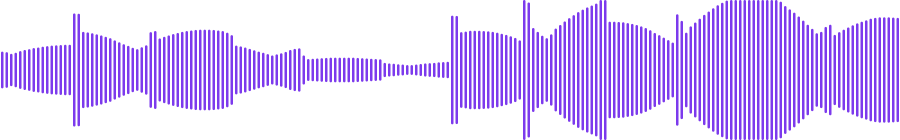
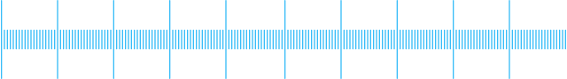

# bravoh-peaks

**Generate, encode, decode & render SoundCloud-style audio waveform peaks — in one tiny, zero-dependency package.**

[](https://www.npmjs.com/package/bravoh-peaks)
[](https://www.npmjs.com/package/bravoh-peaks)
[](package.json)
[](src/format.ts)
[](LICENSE)

<p align="center"></p>

Every audio app ends up reinventing the same thing: turn a track into a small array of amplitudes so you can draw a waveform. Most do it badly — a Float32 dump over the wire, a re-decode on every render, a home-grown base64 that isn't quite reversible, no way to prove the peaks belong to *this* file.

`bravoh-peaks` is the version we extracted from [BRAVOH](https://bravoh.ai)'s production music-AI app: a **self-describing versioned format** (`audio-peaks.v1`), a **canonical encoder** (`max-abs-all-channels`), a strict **decoder**, a **WAV reader**, an **SVG renderer**, and a **CLI** — with **no runtime dependencies** and **byte-for-byte parity** against an independent Python reference.

```
npm install bravoh-peaks
```

---

## 30-second quickstart

**In the browser** — decode any audio the platform understands, then peak it:

```ts
import { encodeAudioPeaks, renderPeaksSvg } from "bravoh-peaks";

const buffer = await new AudioContext().decodeAudioData(await file.arrayBuffer());
const channels = Array.from({ length: buffer.numberOfChannels }, (_, c) => buffer.getChannelData(c));

const peaks = encodeAudioPeaks(channels, { sampleRateHz: buffer.sampleRate, bucketCount: 400 });
document.querySelector("#wave").innerHTML = renderPeaksSvg(peaks, { color: "#7c3aed" });
```

**In Node** — straight from a WAV file, with the asset hash computed for you:

```ts
import { readFileSync } from "node:fs";
import { peaksFromWav, expandAudioPeaks } from "bravoh-peaks";

const peaks = peaksFromWav(readFileSync("track.wav"), { bucketCount: 192 });
// → { version: "audio-peaks.v1", bucketCount: 192, payload: "OTo6…", assetSha256: "a235…", … }

const envelope = expandAudioPeaks(peaks); // number[] in [0, 1], ready to draw
```

**From the shell** — no install needed:

```console
$ npx bravoh-peaks track.wav --buckets 500 --svg wave.svg
{"version":"audio-peaks.v1","algorithm":"max-abs-all-channels.v1",…}
```

<p align="center"></p>

---

## Why a *format*, not just a helper

The receipt is small, self-describing, and content-addressable:

```jsonc
{
  "version": "audio-peaks.v1",
  "algorithm": "max-abs-all-channels.v1",
  "assetSha256": "a2356f5a…799ea",   // optional: binds these peaks to exact source bytes
  "sampleRateHz": 44100,
  "channels": 1,
  "frameCount": 44100,
  "durationMs": 1000,
  "bucketCount": 192,
  "encoding": "u8-base64url",         // 192 bytes → ~256 base64url chars
  "normalization": "asset-peak",      // 1.0 == the loudest bucket in the file
  "maxAmplitude": 0.79998779,
  "payload": "OTo6Ojo7PDw-…"
}
```

- **One `Uint8` per bucket, unpadded base64url** — a 192-point waveform is ~256 bytes of JSON, not a Float32 array. Cache it, put it in a column, ship it in a page.
- **Strict, canonical decode** — the decoder rejects padding, stray characters, and non-canonical trailing bits, so a payload round-trips to exactly the bytes it came from, or throws.
- **`assetSha256` binds peaks to an asset** — recompute it, compare, and you know the waveform matches the audio a viewer is about to hear. Optional; omit it for a bare waveform.
- **Versioned** — `version` + `algorithm` are literals, so a consumer can refuse anything it doesn't understand instead of mis-drawing it.

---

## API

Everything is tree-shakeable and works in the browser, Node, Deno, Bun, and workers.

| Export | Signature | What it does |
| --- | --- | --- |
| `encodeAudioPeaks` | `(channels: Float32Array[], opts) => AudioPeaks` | Canonical `max-abs-all-channels.v1` encode from decoded PCM. |
| `expandAudioPeaks` | `(peaks) => number[]` | Validate + decode a receipt to `[0, 1]` values. |
| `peaksFromWav` | `(bytes, opts?) => AudioPeaks` | Decode a WAV + compute `assetSha256` + encode, in one call. |
| `decodeWav` | `(bytes) => { channels, sampleRateHz, frameCount }` | Minimal PCM/float WAV reader (8/16/24/32-bit, mono/multi). |
| `renderPeaksSvg` | `(peaks \| number[], opts?) => string` | Standalone SVG string — `mirror`, `bars`, or `line`. |
| `parseAudioPeaks` / `isAudioPeaks` | `(value) => AudioPeaks` / `boolean` | Zero-dependency strict validation + type narrowing. |
| `encodeBase64Url` / `decodeBase64Url` | `(Uint8Array) ⇄ string` | The strict unpadded base64url primitive. |
| `sha256Hex` | `(bytes) => string` | Sync, dependency-free SHA-256 → lowercase hex. |

**`EncodeOptions`**: `{ sampleRateHz: number; bucketCount?: number /* default 192 */; assetSha256?: string }`

**`RenderSvgOptions`**: `{ width?, height?, color?, background?, gap?, radius?, minBarHeight?, style? }`

### The algorithm, in one paragraph

Split the frames into `bucketCount` evenly-spaced windows. For each window take the **maximum absolute sample across all channels**. Normalise the whole envelope by the loudest bucket (`asset-peak`), quantise each value to a `Uint8` with round-half-up, and serialise as unpadded base64url. `bucketCount` is clamped to the frame count, so short clips still produce an honest, shorter waveform. Silence encodes as a measured run of zeros — never missing data.

---

## Correctness

The encoder is verified **byte-for-byte against an independent Python + numpy reference** (the one that runs in production). Three fixtures — a mono sine sweep, quiet pulses, and stereo transients — must reproduce their golden receipts exactly, payload and all. `sha256Hex` is checked against FIPS 180-4 vectors and every block-boundary padding case. See [`test/`](test).

```console
$ npm test
 ✓ golden parity with the Python reference (4)
 ✓ sha256Hex (3)   ✓ base64url codec (3)   ✓ encodeAudioPeaks (7)   …
 Tests  32 passed
```

## Scope (and non-goals)

- **In scope:** peak extraction from already-decoded PCM, a compact wire format, WAV input, SVG output, a CLI.
- **Not in scope:** decoding compressed audio (MP3/AAC/OGG/FLAC). Decode those with the platform — `AudioContext.decodeAudioData`, ffmpeg, `node-web-audio-api` — and pass the channel data to `encodeAudioPeaks`. Keeping codecs out is why this package has zero dependencies.
- **Not a DSP suite:** no RMS/loudness/spectral analysis here. `max-abs` is the right envelope for *drawing* a waveform.

## Contributing

Issues and PRs welcome — especially:

- **`peaksFromWav` for more real-world WAVs** — odd chunk orders, extensible headers, 24-bit files. Send a fixture.
- **A second render target** — a `<canvas>` / `OffscreenCanvas` drawer alongside the SVG one.
- **A framework adapter** — a tiny React/Svelte `<Waveform>` that takes a receipt.

Good first issues are tagged on the tracker. Run `./gates.sh` (or `.\gates.ps1` on Windows) before opening a PR — it runs the secret scan, typecheck, tests, build, and a pack sanity check.

## License

MIT © BRAVOH. Part of [BRAVOH open source](https://github.com/ozzaii) — we open-source the instruments, not the orchestra.
